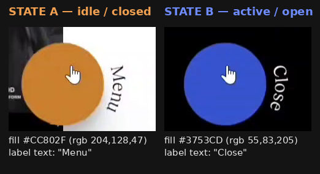
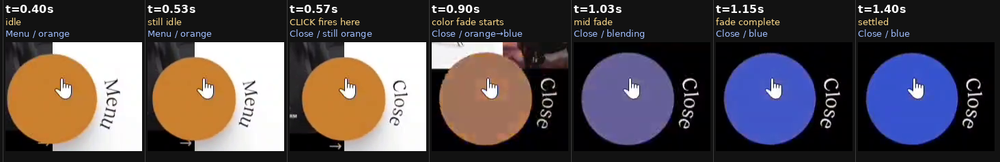

# Floating "Menu / Close" Toggle Button — Full Behavior Spec

Reverse-engineered frame-by-frame from `VideoEditor_20260905_073405.mp4`
(1920×624, 24 fps, 18.08s, silent audio track — no narration to work from,
this is pure pixel analysis).

**Confidence key** — every claim below is tagged:
- ✅ **Confirmed** — measured directly from video pixels (color-sampled,
  frame-timed, or bounding-boxed with code).
- 🟡 **Inferred** — not actually shown on tape, but follows from an
  unambiguous UI convention.
- ⚠️ **Best guess** — the video doesn't give enough information to be sure;
  a reasonable reconstruction.

## TL;DR

It's a circular floating button, fixed near the bottom-center of the page.
It has exactly two states, and a click toggles between them:

| | State A — closed | State B — open |
|---|---|---|
| Fill color | ✅ `#CC802F` — warm amber-orange | ✅ `#3753CD` — indigo blue |
| Label (rotated 90° next to the circle) | ✅ "Menu" | ✅ "Close" |

On the one click this recording fully shows: **the label swaps instantly**,
then **~300ms later the fill starts a ~280ms cross-fade** to the new color,
in step with a fixed black strip (which also holds a "FOLLOW US" social
block) fading in behind the button. The clip ends with the mouse
re-parked on the button as if for a second click — but that click, and
its reverse animation, never actually happens on camera. Section 5 covers
what "press again" should do, clearly marked as inferred rather than
observed.

---

## 1. What I actually watched

The upload is a 1920×624px, 24fps, 18.08s screen recording with a visible
desktop mouse cursor (not a touch recording). The unusual wide/short
aspect ratio means it's a vertically-cropped slice of a taller recording
— whoever made it (filename suggests a "VideoEditor" app) trimmed it down
to just the band containing the nav bar, hero content, and this button
before sending it to me. That matters for one thing: I can trust the
button's **horizontal** position completely (nothing was cut off
left/right), but I can't know its true **vertical** position on the real
page, since top/bottom material was removed before I ever saw the file.

The site itself is a digital-agency / e‑commerce portfolio page (nav:
HOME, WORK, EXPERTISE, ABOUT, CONTACT, JOIN US, KNOWLEDGE; hero copy "WE
BUILD BRANDS & DIGITAL FLAGSHIP STORES"; client work shown includes
adidas, Y‑3, and IVY PARK). That's background context, not the point of
this doc — the button is.

I found the button's exact pixel box by color-thresholding every frame
(connected-component analysis, not eyeballing): a perfect circle at
`x:894–1025, y:428–559` in the source frame, center `(959, 493)`, i.e.
**dead-center horizontally** (49.95% of the 1920px width).

## 2. Visual anatomy



| Property | Value | Confidence |
|---|---|---|
| Shape | Perfect circle, flat fill, no border/stroke | ✅ |
| Diameter | ~132px at this capture's scale (1920px-wide), i.e. ~6.9% of viewport width | ✅ |
| Horizontal position | Centered exactly at 50% of viewport width, fixed (doesn't move as the page's own horizontal section-scroller advances behind it) | ✅ |
| Vertical position | Near the bottom of the visible band; exact offset unknown because the source was pre-cropped vertically before I received it | ⚠️ |
| Drop shadow | Soft, diffuse, offset downward — confirmed by sampling pixels directly below the circle on a white background: they read as neutral gray (e.g. `(181,183,180)`) rather than pure white, fading back to white over ~15–20px | ✅ (presence) / ⚠️ (exact blur/spread values) |
| Cursor | Browser default hand/pointer icon appears whenever the mouse is over the circle — this is just `cursor: pointer`, not a custom asset | ✅ |
| Label text | "Menu" when closed, "Close" when open — capital first letter, rest lowercase | ✅ |
| Label position | To the right of the circle, ~14px gap from the circle's edge to the text | ✅ |
| Label orientation | Rotated **90° clockwise** from normal horizontal text. Equivalent test: read the word top-to-bottom — first letter is at the **top** ("M" of Menu, "C" of Close), last letter at the **bottom**. That is exactly what `transform: rotate(90deg)` does to a normal left-to-right string. | ✅ |
| Label color | White / near-white (brightest sampled pixels hit pure `(255,255,255)`, most cluster `237–255`) | ✅ |
| Label typeface | A serif face (visible flared terminals on "M", "C", "l") — clearly different from the sans-serif nav bar elsewhere on the page. Exact font family isn't identifiable from compressed video. | ⚠️ |
| Label size | Text block spans roughly 22–24px in the "cap-height" direction at this capture scale → try a 26–28px font-size and adjust to taste | ⚠️ |
| Hover-only effect | None found — I checked a frame where the cursor was a plain arrow (not the hand) resting just outside the circle while state = open, and the fill color was still exactly the same blue as every hand-cursor frame. Color is tied purely to open/closed state, not to hover. | ✅ |

## 3. State machine

```
        click                click
 [CLOSED] ───────▶ [OPEN] ───────▶ [CLOSED]  (toggles back and forth)
 Menu/orange        Close/blue
```

| | **Closed** (default) | **Open** (after 1 click) |
|---|---|---|
| Fill | `#CC802F` `rgb(204,128,47)` | `#3753CD` `rgb(55,83,205)` |
| Label | "Menu" | "Close" |
| Fixed black strip behind button | Not visible / transparent (page content shows through) | Opaque solid black |
| "FOLLOW US" + social icons | Not visible in my crop at this state | Visible, black background, right side of the same strip |

## 4. Press #1 — the full, observed sequence

This is the one full cycle actually captured on tape, reconstructed at
native 24fps (≈42ms per frame) around the click itself:



| Clip time | What happens |
|---|---|
| 0.00s – ~0.52s | Idle. Mouse (hand cursor) already resting on the button. Fill orange, label "Menu". Page behind is whatever was scrolled there (white hero panel, in this capture). Nothing changes for half a second. |
| **~0.55s** | **The click.** Registers somewhere in the ~42ms window between the last "Menu" frame (0.525s) and the first "Close" frame (0.567s). |
| ~0.55s – ~0.57s | Label swaps `"Menu" → "Close"` **instantly** — no crossfade or animation on the text itself, just a hard swap, visible in the very next frame. |
| ~0.55s (briefly) | A small "→" glyph flickers below-left of the button for a couple of frames. This is very likely an unrelated, adjacent piece of page content (e.g. a scroll affordance in the hero section) that happens to be in the crop and gets covered a moment later — flagging it so you don't mistake it for part of the button, but I wouldn't build it in as the button's own behavior. |
| ~0.57s – ~0.85s | Label already reads "Close", but **fill is still the old orange.** The color hasn't started moving yet. Meanwhile the backdrop behind the button is transitioning from the page's normal content to solid black (this settles slightly faster than the button's own recolor). |
| ~0.85s – ~1.10s | **Fill color cross-fades**, orange → blue, passing through visibly blended intermediate hues (dusty brown → mauve → periwinkle) consistent with a plain `background-color` transition — roughly a 250–300ms duration. |
| ~1.10s onward | Fully settled: solid blue circle, "Close" label, sitting on an opaque black strip, "FOLLOW US" + two social icons visible to the right. |
| ~1.15s → 17.9s (rest of clip) | **Completely static.** No further change to the button for the remaining ~16+ seconds, even though the page's own horizontal section-scroller keeps independently cycling through HOME → WORK → EXPERTISE → ABOUT (and further, judging by background art glimpsed at the crop edges) in the area above this fixed strip. That horizontal scroll is a separate, ongoing page behavior — it is not caused by, or synced to, this button. |

**Net timing to hand to an animator/dev:** label change = instant (0ms
delay, 0ms duration). Fill color = ~300ms delay, then ~280ms transition.
Backdrop opacity/color = starts immediately, ~250–300ms duration, no
delay. Total time from click to fully-settled: **~600ms**.

## 5. Press #2 — inferred reverse (🟡 not captured on tape)

Here's exactly what the recording shows near the end, and where it stops:

- From ~16.2s, the mouse cursor — which had been off-frame/idle for a
  while — sweeps in from off-screen at the bottom-left and arrives back
  over the button by ~16.5s (hand cursor reappears, confirming it's
  hovering the clickable circle).
- It stays parked there, unmoving, for the rest of the clip.
- **The recording ends at 18.08s with the button still showing "Close" /
  blue.** No second click, and no reverse animation, is actually visible
  — the clip simply runs out right as the user appears to be lining up
  another click.

Because "Menu" / "Close" is about as standard a toggle-button convention
as exists, I'm confident (🟡 inferred, not observed) the second press is
meant to be the **exact mirror** of section 4:

1. Instant label swap, `"Close" → "Menu"`.
2. ~300ms later, fill cross-fades blue → orange over ~280ms.
3. The black backdrop strip fades back out (transparent again), revealing
   whatever page content is currently scrolled underneath.
4. "FOLLOW US" + social icons disappear along with the backdrop.

If you're building this and exactness matters, treat this section as a
mirrored starting point to implement and eyeball — not as something
verified pixel-for-pixel the way section 4 is.

## 6. What I could not verify

Being upfront about the edges of this analysis:

- **Exact font family** of the label — I can tell it's a serif display
  face, not which one.
- **Exact easing curve** for the color cross-fade — the handful of
  in-between frames I could sample look consistent with simple linear
  RGB interpolation (plain `ease` or `linear`), but I only have ~5-6
  samples through the transition, not enough to fit a precise
  cubic-bezier curve.
- **Press/active micro-interaction** — no scale-down or squash effect was
  visible in any sampled frame, but a real click is often faster than my
  ~42ms native frame spacing, so I can't fully rule out something under
  ~40ms.
- **True vertical position** on the real page — lost when the video was
  cropped before I received it.
- **Full scope of "open"** — I can confirm the strip immediately around
  the button (plus the "FOLLOW US" block) goes from
  transparent/page-colored to opaque black. I can't confirm whether
  "Close" also corresponds to some larger full-screen menu overlay
  elsewhere on the page outside the region I could see — I'm reporting
  exactly what was visible in the crop, not extrapolating a bigger
  mega-menu I didn't actually see.

## 7. Drop-in implementation (React + TypeScript + CSS)

This reproduces everything in sections 2–4 as directly as possible.
Parts flagged ⚠️ in the comments are reconstructions, not verified fact —
tune them against your own design.

```tsx
// MenuToggleButton.tsx
import { useState } from "react";
import "./MenuToggleButton.css";

type ToggleState = "closed" | "open";

export function MenuToggleButton() {
  const [state, setState] = useState<ToggleState>("closed");
  const isOpen = state === "open";

  function handleClick() {
    setState(isOpen ? "closed" : "open");
  }

  return (
    // ⚠️ RECONSTRUCTED: a fixed-height bottom strip whose background
    // flips transparent <-> opaque black. Confirmed from the recording:
    // this area is page-colored when closed, solid black when open.
    // Its exact height/contents beyond this strip weren't fully visible
    // in the source crop, so size it to fit your own layout.
    <div className={`toggle-strip ${isOpen ? "toggle-strip--open" : ""}`}>
      <div className="toggle-wrapper">
        <button
          type="button"
          className={`toggle-btn ${isOpen ? "toggle-btn--open" : "toggle-btn--closed"}`}
          onClick={handleClick}
          aria-pressed={isOpen}
          aria-label={isOpen ? "Close menu" : "Open menu"}
        >
          {/* Intentionally empty: the source button is a plain colored
              circle with no icon/glyph inside it, just the cursor. */}
        </button>

        {/* Rotated label. Plain hard swap of the text — no crossfade
            was observed on the text itself. */}
        <span className="toggle-label" aria-hidden="true">
          {isOpen ? "Close" : "Menu"}
        </span>
      </div>

      {/* ⚠️ RECONSTRUCTED supporting element seen alongside the button
          in the open state — secondary to this spec, included for
          completeness. Swap in real icons/links. */}
      <div className="toggle-follow">
        <span>FOLLOW US</span>
      </div>
    </div>
  );
}
```

```css
/* MenuToggleButton.css */

:root {
  --btn-diameter: 132px;      /* ✅ measured at 1920px-wide capture scale */
  --btn-color-closed: #CC802F; /* ✅ measured */
  --btn-color-open: #3753CD;   /* ✅ measured */
  --btn-label-color: #FFFFFF;  /* ✅ measured */
  --btn-label-gap: 14px;       /* ✅ measured */
}

.toggle-strip {
  position: fixed;
  left: 0;
  right: 0;
  bottom: 0;
  height: 190px; /* ⚠️ unverified — tune to your layout */
  display: flex;
  align-items: center;
  justify-content: center; /* centers .toggle-wrapper (== the button) at 50% */
  background-color: transparent;
  transition: background-color 300ms ease; /* starts immediately on click */
  pointer-events: none; /* re-enabled on the interactive children below */
}
.toggle-strip--open {
  background-color: #000000;
}

.toggle-wrapper {
  position: relative; /* anchors the absolutely-positioned label */
  display: inline-block;
  width: var(--btn-diameter);
  height: var(--btn-diameter);
  pointer-events: auto;
}

.toggle-btn {
  width: 100%;
  height: 100%;
  border-radius: 50%;
  border: none;
  cursor: pointer; /* the "hand" cursor seen throughout the recording */
  box-shadow: 0 18px 30px rgba(0, 0, 0, 0.28); /* ⚠️ approximate, presence confirmed */
  background-color: var(--btn-color-closed);
  /* The ~300ms stagger before the color itself starts moving: */
  transition: background-color 280ms ease 320ms;
}
.toggle-btn--open {
  background-color: var(--btn-color-open);
}

.toggle-label {
  position: absolute;
  top: 50%;
  left: calc(100% + var(--btn-label-gap));
  transform-origin: left center;
  transform: translateY(-50%) rotate(90deg); /* first letter ends up on top */
  white-space: nowrap;
  color: var(--btn-label-color);
  font-family: Georgia, "Times New Roman", serif; /* ⚠️ best-guess serif */
  font-size: 27px; /* ⚠️ approximate, 26-28px range */
  letter-spacing: 0.5px;
  pointer-events: none;
}

/* ⚠️ RECONSTRUCTED */
.toggle-follow {
  position: absolute;
  right: 48px;
  display: flex;
  align-items: center;
  gap: 16px;
  color: #fff;
  opacity: 0;
  transition: opacity 250ms ease 150ms;
  pointer-events: none;
}
.toggle-strip--open .toggle-follow {
  opacity: 1;
  pointer-events: auto;
}
```

**Section 5 (the untested reverse) needs no extra code** — because both
transitions above key off the same `isOpen` boolean, clicking a second
time automatically plays every transition backwards using the same
timing. That's the mirrored behavior from section 5, for free.

## 8. Quick-reference cheat sheet

| Thing | Closed | Open |
|---|---|---|
| Fill | `#CC802F` | `#3753CD` |
| Label | Menu | Close |
| Backdrop strip | transparent | `#000000` |
| Label rotation | `rotate(90deg)`, first letter at top | same |
| Diameter | ~132px | same |
| Shadow | soft, offset down | same |

| Transition leg | Delay | Duration |
|---|---|---|
| Label text swap | 0ms | 0ms (instant) |
| Button fill color | ~300ms | ~280ms |
| Backdrop strip color/opacity | 0ms | ~250–300ms |
| **Total settle time** | | **~600ms** |
